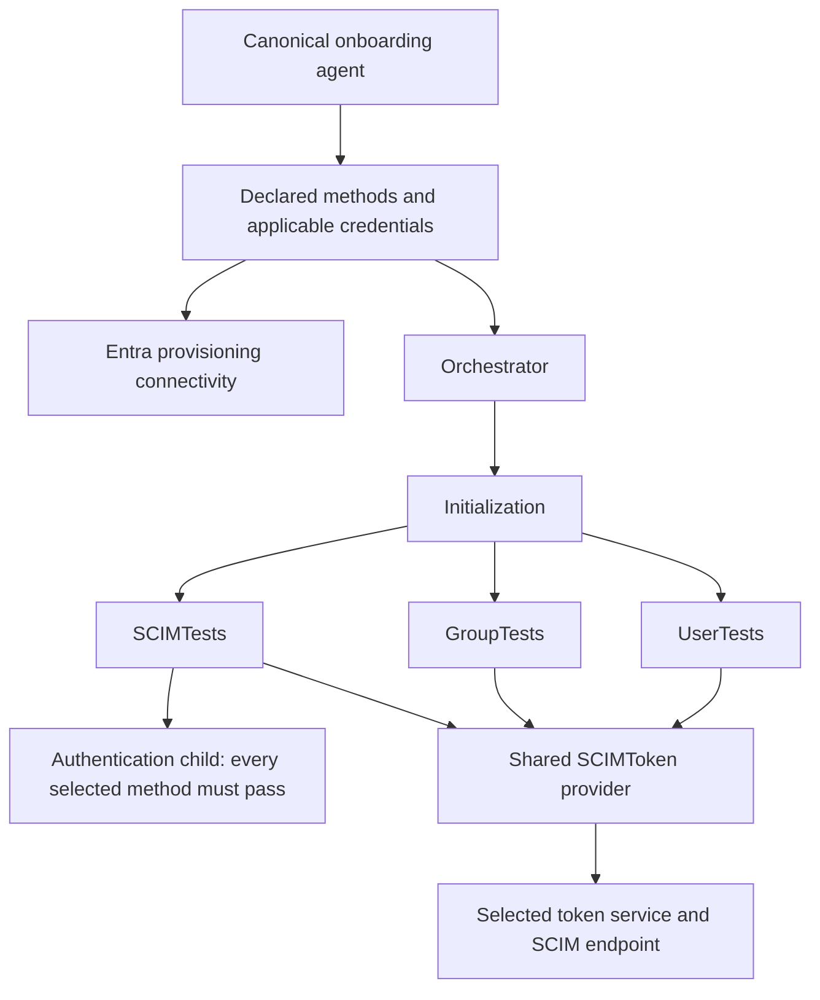

# Authentication-aware SCIM validation

## Executive summary

This authentication-first change lets an independent software vendor (ISV)
declare the authentication methods available in its validation environment.
Every selected method must pass. An undeclared method is Not applicable and
does not issue authentication requests.

This change advances [VERSION](VERSION) from 13.0 to 14.0 and synchronizes
`LogicAppVersion`. Portable JSON/Markdown/ZIP reporting, report collection,
and agent lifecycle instrumentation are a separate dependent change.

## Scope and behavior

| Concern | Authentication-first behavior |
|---|---|
| Capability selection | Accept explicit `supportedAuthenticationMethods`, or ask a specific choice. |
| Credentials | Collect only credentials for declared methods. Missing selected credentials block readiness. |
| Readiness | AND across all selected methods; a selected failed, skipped, or missing result cannot be waived. |
| Undeclared method | Not applicable, with no token acquisition or federation requests. |
| Direct SCIM transport | Select one declared method using `scimAuthenticationMethod`; this does not deselect the other authentication tests. |
| Token lifetime | Acquire and refresh OAuth/federation tokens; no static-token fallback. |
| Static bearer | Connectivity/functional validation only; not gallery-ready without a selected passing gallery method. |
| Functional tests | Mandatory provisioning failures remain independent blockers. |

For OAuth-only or federation-only runs, set `scimBearerToken` to an empty
string. Receiving an OAuth access token in an HTTP bearer header does not
mean that caller-supplied static bearer authentication is supported.

## Workflow architecture



There are seven workflows and 25 reportable tests. Extracting authentication
keeps the SCIM suite below the platform's 500-action limit. The shared token
provider supports long-running functional suites without requiring a static
token. Neither child adds a new gallery test.

| Workflow | Nested actions |
|---|---:|
| Authentication | 42 |
| SCIMTests | 465 |
| UserTests | 465 |
| GroupTests | 404 |
| Initialization | 99 |
| Orchestrator | 29 |
| SCIMToken | 27 |

## Worked example

```json
{
  "supportedAuthenticationMethods": [
    "OAuth2ClientCredentials",
    "WorkloadIdentityFederation"
  ],
  "scimAuthenticationMethod": "OAuth2ClientCredentials"
}
```

Core SCIM requests use OAuth, but both authentication tests must pass.
Choosing OAuth transport does not make federation Not applicable. A
federation-only environment instead declares only federation and needs no
invented OAuth endpoint.

## Verification and boundaries

Run [Test-Authentication.ps1](Test-Authentication.ps1). It evaluates actual
workflow expressions, policy combinations, token refresh, protected token
handling, platform limits, and all 99 direct SCIM request guards.

Use the same-revision [canonical agent](scim-onboarding.agent.md),
[setup walkthrough](SetupLogicApp-Standard-Agent.md), and
[test overview](SCIM-Validation-Test-Overview.md). Keep production Graph
URLs in source; authorized development routing belongs in a private
deployment overlay.

The earlier combined change set exercised OAuth and exposed group member
schema incompatibilities and a secondary diagnostic-expression defect.
That historical run is not certification of this newly separated branch.
A fresh auth-only validation is required. Live federation success still
requires a federation-capable endpoint. Do not change unrelated functional
tests or endpoint policy merely to obtain a passing demonstration.
